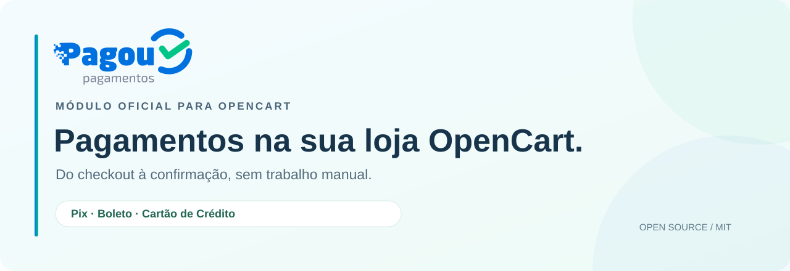

<p align="center">
  
</p>

<p align="center">
  <strong>Pagamentos integrados. Confirmação automática. Código aberto.</strong><br>
  O módulo oficial da Pagou para receber na sua loja OpenCart.
</p>

<p align="center">
  <a href="CHANGELOG.md"></a>
  <a href="#requisitos"></a>
  <a href="#requisitos"></a>
  
  <a href="https://github.com/pagou-com-br/pagou-opencart/releases/tag/v1.1.1"></a>
  <a href="LICENSE"></a>
</p>

<p align="center">
  <a href="https://github.com/pagou-com-br/pagou-opencart/releases/download/v1.1.1/pagou-opencart3-1.1.1.ocmod.zip"><strong>Baixar para OpenCart 3.0.x (.zip)</strong></a>
  &nbsp;·&nbsp;
  <a href="https://github.com/pagou-com-br/pagou-opencart/releases/download/v1.1.1/pagou.ocmod.zip"><strong>Baixar para OpenCart 4.x (.zip)</strong></a>
  <br>
  <a href="https://github.com/pagou-com-br/pagou-opencart/releases/tag/v1.1.1">Release notes</a>
  &nbsp;·&nbsp;
  <a href="https://github.com/pagou-com-br/pagou-opencart/releases/download/v1.1.1/SHA256SUMS">Checksum SHA-256</a>
</p>

<p align="center">
  <a href="#recursos">Recursos</a> ·
  <a href="#requisitos">Requisitos</a> ·
  <a href="#instalacao">Instalação</a> ·
  <a href="#configuracao">Configuração</a> ·
  <a href="#atualizacao">Atualização</a> ·
  <a href="#seguranca">Segurança</a> ·
  <a href="#licenca">Licença</a>
</p>

> **Pré-release `1.1.1`.** Pix e Boleto em produção na primeira loja piloto; cartão em validação. Teste no Sandbox, com o
> **Modo de teste** ligado, antes de abrir para os clientes. No OpenCart 4, o arquivo
> **precisa** se chamar `pagou.ocmod.zip`: não renomeie.

Receba por **Pix**, **Boleto** e **Cartão de crédito** na sua loja OpenCart usando a [Pagou](https://pagou.com.br).

| OpenCart | Pacote | Situação |
| --- | --- | --- |
| 3.0.x (3.0.2.0 a 3.0.5.x) | `pagou-opencart3-<versão>.ocmod.zip` | Em validação (loja piloto em 3.0.5.1) |
| 4.0.2.x e 4.1.x | `pagou.ocmod.zip` | Em validação; 4.0.0/4.0.1 não suportados (rotas com `|`). A aba "Pagou" no pedido do admin exige 4.0.2.3+ (bug do core no 4.0.2.0-4.0.2.2) |

<a id="recursos"></a>

## O que a extensão faz

- **Pix**: gera o QR Code e o Pix Copia e Cola numa página de pagamento própria, com contagem regressiva e confirmação automática.
- **Boleto**: emite o boleto com vencimento, multa e juros configuráveis; mostra a linha digitável, os links HTML/PDF e o Pix embutido no boleto, quando a conta oferece.
- **Cartão de crédito**: o cartão é tokenizado no navegador com a biblioteca oficial (número e CVV nunca passam pelo servidor da loja), com parcelamento até 12x e valor mínimo de parcela. A loja escolhe até quantas parcelas absorve a tarifa (sem juros) e, acima disso, repassa juros ao comprador: [juros ao mês (tabela Price) ou acréscimo fixo por parcela](#juros-do-parcelamento).
- **Confirmação por webhook** com assinatura HMAC validada, deduplicação de eventos e proteção contra regressão de status (um aviso atrasado nunca "despaga" um pedido).
- **Conciliação por cron**: consulta na API as cobranças em aberto, para o caso de um webhook não chegar.
- **Modo de teste com visibilidade restrita**: os meios da Pagou só aparecem para IPs ou e-mails liberados. Dá para testar no Sandbox dentro da loja real sem nenhum cliente ver.
- **Aba "Pagou" no pedido** do admin, com o histórico das cobranças, a consulta manual e o link de pagamento do cliente.
- Mapeamento de **CPF/CNPJ, número, complemento e bairro** para os campos personalizados que a loja já usa. Se a loja não coleta CPF/CNPJ, o checkout pede no passo de pagamento.

<a id="requisitos"></a>

## Requisitos

- PHP 7.4 ou superior, com `curl` e `json`.
- Conta Pagou ativa e a chave de API do ambiente (painel Pagou: **Configurações → API**).
- Para cartão: **credenciamento aprovado** (painel Pagou: **Configurações → Cartão de crédito**). No Sandbox a liberação é feita pelo suporte da Pagou.
- Loja com HTTPS público, para receber os webhooks.

<a id="instalacao"></a>

## Instalação

### OpenCart 3.0.x

1. **Extensões → Instalador**: envie `pagou-opencart3-<versão>.ocmod.zip`.
2. **Extensões → Extensões → Pagamentos**: instale **Pagou - Pix**, **Pagou - Boleto** e/ou **Pagou - Cartão de crédito**.
3. Abra qualquer um deles e preencha a **Conta Pagou**. Esse bloco é compartilhado: vale para os três meios.

### OpenCart 4.x

1. **Extensões → Instalador**: envie `pagou.ocmod.zip` e clique em instalar. O arquivo **precisa** se chamar `pagou.ocmod.zip`, porque o OpenCart 4 usa o nome do arquivo como código da extensão.
2. **Extensões → Extensões → Pagamentos**: instale os meios desejados e configure como acima.

<a id="configuracao"></a>

## Configuração recomendada

1. Comece em **Sandbox**, com o **Modo de teste** ligado e o seu e-mail ou IP liberado.
2. Clique em **Testar conexão** ao lado da chave.
3. Em **Dados do comprador**, aponte os campos personalizados de CPF/CNPJ, número e complemento. O bairro costuma ficar em "Endereço linha 2".
4. Atrás da Cloudflare, escolha `CF-Connecting-IP` em **IP real do comprador**. Esse IP vai para o antifraude do cartão.
5. Agende o **cron de conciliação** mostrado na tela, a cada 10 minutos:
   ```
   */10 * * * * curl -s "https://sualoja.com.br/index.php?route=...&token=..." > /dev/null
   ```
6. Faça um pedido de cada meio. No Sandbox, a página de pagamento tem o botão **Simular pagamento** para Pix e boleto; para cartão, use `4111 1111 1111 1111`.
7. Para entrar em produção, troque para **Produção**, cole a chave de produção e desligue o **Modo de teste**.

A URL de notificação (webhook) é enviada automaticamente em cada cobrança: não precisa cadastrar nada no painel da Pagou.

<a id="juros-do-parcelamento"></a>

### Juros do parcelamento (cartão)

A API da Pagou recebe só o **valor total** e o **número de parcelas**; a tarifa do cartão é cobrada da loja conforme o plano. Para repassar juros ao comprador, configure em **Pagou - Cartão de crédito**:

| Campo | O que faz |
| --- | --- |
| **Máximo de parcelas** | De 1 a 12 (a bandeira também pode limitar). |
| **Parcelas sem juros até** | Até essa quantidade a loja absorve a tarifa. Vazio = todas sem juros (comportamento da 1.0). `1` = só à vista sem juros. |
| **Juros acima disso** | **Juros ao mês (tabela Price)**: parcela calculada com a taxa mensal, arredondada ao centavo, total = parcela × quantidade. **Acréscimo fixo por parcela (tabela)**: percentual sobre o total para cada quantidade, ex. `4=6,5; 5=7,9`; quantidade acima da faixa sem juros e fora da tabela não é oferecida. |
| **Juros ao mês (%)** | Usado na tabela Price. Sugestão da Pagou: **3,49**. |
| **Valor mínimo da parcela** | Considera a parcela já com juros. 1x é sempre oferecida. |

Exemplo com 3,49% ao mês e só o à vista sem juros, num pedido de R$ 1.000,00: 2x de R$ 526,32 (total R$ 1.052,64), 6x de R$ 187,61 (R$ 1.125,66), 12x de R$ 103,42 (R$ 1.241,04).

O checkout mostra cada opção com a parcela e o total. Ao enviar o cartão, os juros entram no pedido como a linha **"Juros do parcelamento (Nx)"**, antes do Total, e o pedido passa a valer exatamente o que foi cobrado na Pagou (e-mails, fatura, admin e conferência de valor). O valor é sempre recalculado no servidor: o navegador só escolhe a quantidade de parcelas. Se o cartão for recusado, ou se o comprador trocar para Pix ou boleto, a linha é removida e o total volta ao original.

Limitação: editar o pedido pelo admin do OpenCart recalcula os totais pelo carrinho e remove a linha de juros. Para um pedido de cartão já cobrado, não edite produtos ou valores pelo admin.

<a id="atualizacao"></a>

## Atualização e desinstalação

- **OpenCart 3:** envie o pacote novo pelo Instalador; os arquivos são substituídos e as configurações são mantidas.
- **OpenCart 4:** o instalador recusa uma extensão cuja pasta já existe. Para atualizar, **nesta ordem**: anote a configuração de cada meio; em **Extensões → Pagamentos**, desinstale os três meios; em **Extensões → Instalador**, desinstale e depois exclua a extensão Pagou; envie o `pagou.ocmod.zip` novo, instale, e instale os meios de novo. A chave de API, o mapeamento de campos, os status e o histórico de cobranças são mantidos; a configuração própria de cada meio (situação, título, parcelas, juros, vencimento) volta ao padrão e os meios ficam **desabilitados** até você revisar e habilitar.
- **Não desinstale os três meios com Pix ou boletos em aberto.** O webhook e o cron fazem parte da extensão; sem ela, pagamentos feitos depois não atualizam o pedido. As tabelas `pagou_transaction` e `pagou_event` nunca são apagadas, para preservar o histórico.

## Scripts de terceiros no checkout

O formulário de cartão carrega `node-forge@1.0.0` (jsDelivr, com verificação de integridade SRI) e `https://js.cel.cash/checkout-v2.min.js` (biblioteca de tokenização indicada pela Pagou). Os dois recebem os dados do cartão no navegador. Se a loja usa Content-Security-Policy, libere `cdn.jsdelivr.net` e `js.cel.cash` em `script-src`.

## Status do pedido

| Evento na Pagou | Status do pedido (configurável) |
| --- | --- |
| Pix ou boleto gerado, cartão em análise | Aguardando pagamento |
| Pix pago, boleto pago, cartão capturado | Pago |
| Pix expirado (pela conciliação) | Pix expirado (ou "não alterar") |
| Cobrança cancelada ou boleto rejeitado | Cancelado |
| Estorno integral | Estornado (estorno parcial vira só um comentário no histórico) |
| Cartão recusado | O pedido não muda (só um comentário no histórico); o cliente pode tentar outro cartão |
| Chargeback | Chargeback |

Um pagamento informado com valor **menor** que o da cobrança, ou um boleto "pago com desconto", não libera o pedido: a cobrança fica marcada para conferência e o histórico recebe **um** alerta. Consultas posteriores não liberam o pedido sozinhas.

### Falhas de comunicação

- **Pix e boleto:** se a criação não tiver resposta (timeout ou erro 5xx), a extensão procura a cobrança na listagem da Pagou pelo código do pedido (`oc-<id>`) e pelo valor antes de permitir outra. Durante 3 minutos o cliente vê "aguarde"; a página de pagamento e o cron continuam procurando.
- **Cartão:** a requisição original e a `Idempotency-Key` ficam guardadas e a recuperação repete **a mesma** requisição (a Pagou devolve a resposta já registrada), nunca uma cobrança nova. Isso vale por **30 minutos**. Depois disso o token é apagado, o pedido recebe um alerta para a loja conferir no painel da Pagou e o cliente pode tentar de novo. A recuperação, pelo checkout, pela página de pagamento ou pelo cron, atualiza o pedido normalmente.
- **Cancelar, expirar ou recusar** só altera pedidos que ainda estão aguardando pagamento. Um pedido já pago por outra cobrança, ou que o lojista já avançou, só recebe um comentário.
- Cartão em `authorized` (autorizado e ainda não capturado) fica como "aguardando pagamento"; a extensão não faz captura manual.

## Estrutura do repositório

```
sdk/        Cliente da API, webhook, regras de CPF/endereço/status e motor (sem dependência do OpenCart)
  tests/    php sdk/tests/run.php
oc3/upload/ Extensão OpenCart 3.0.x
oc4/pagou/  Extensão OpenCart 4.x
build/      php build/build.php gera dist/*.ocmod.zip (copia o SDK para dentro de cada pacote)
```

O SDK é a fonte única das regras de negócio: os dois pacotes recebem uma cópia dele no build. Não edite `oc3/upload/system/library/pagou/*.php` nem `oc4/pagou/system/library/sdk/*.php` diretamente; edite `sdk/src` e rode o build.

## Desenvolvimento

```bash
php sdk/tests/run.php   # testes do SDK
php build/build.php     # lint + pacotes em dist/
```

<a id="seguranca"></a>

## Segurança

- A chave de API fica só no servidor. A Pagou ecoa a chave em `metadata` nas respostas; o SDK remove isso antes de qualquer gravação.
- Os webhooks são aceitos só com HMAC-SHA256 válido sobre `timestamp + corpo bruto`, com tolerância de 5 minutos.
- O número do cartão e o CVV não chegam ao servidor da loja; só o token gerado no navegador.
- A página de pagamento e a consulta de status exigem um token HMAC por pedido.

<a id="licenca"></a>

## Licença

MIT. Veja [LICENSE](LICENSE).
